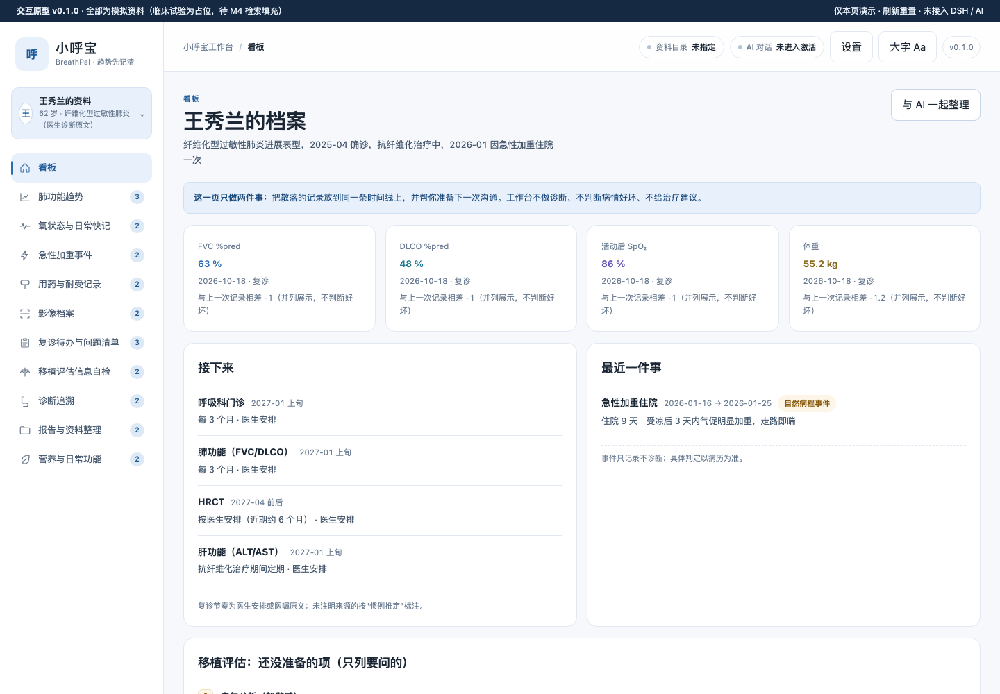
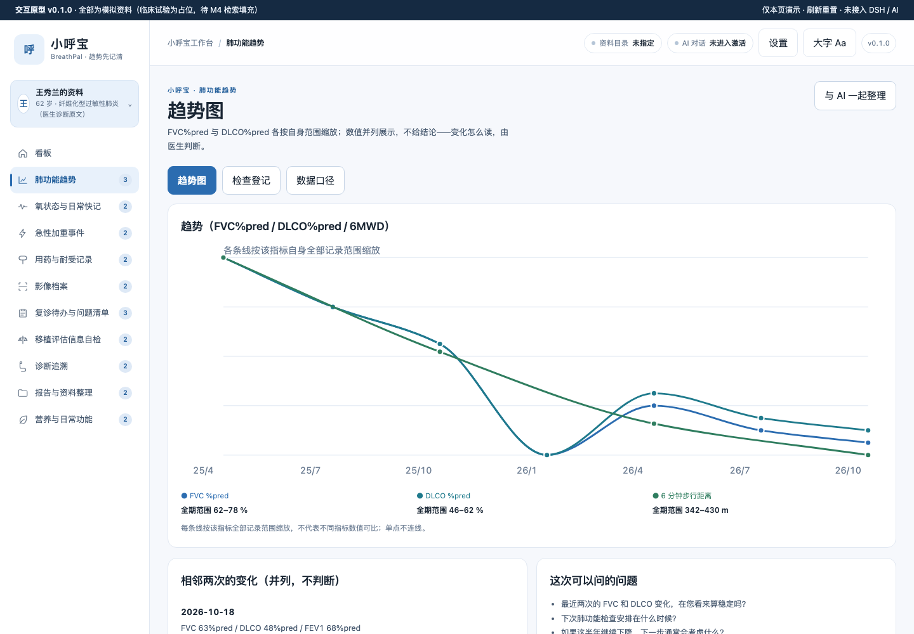
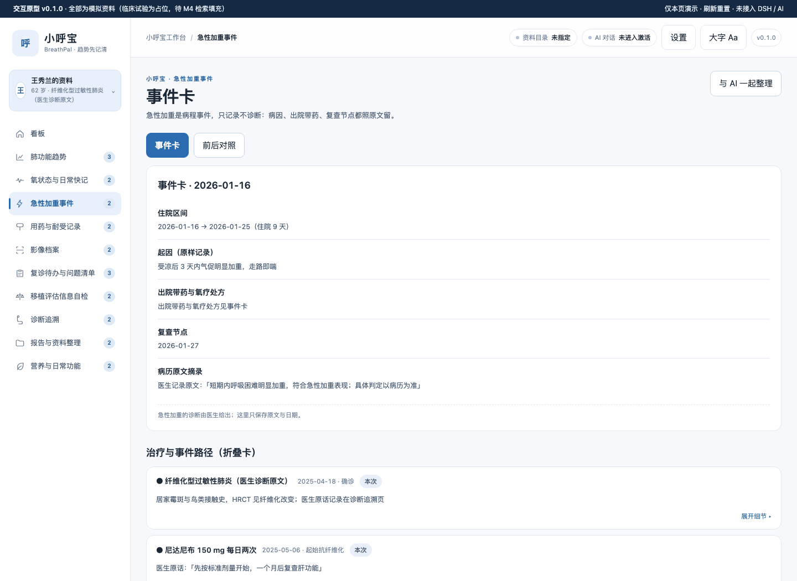
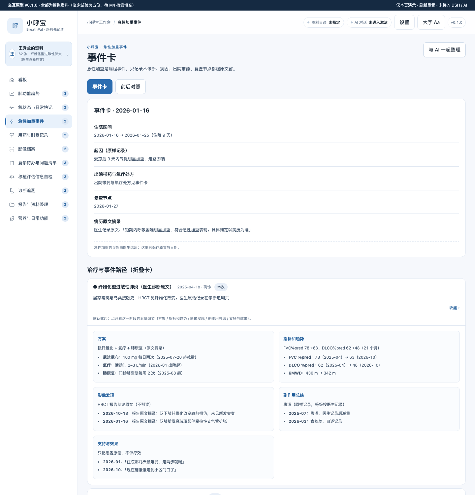
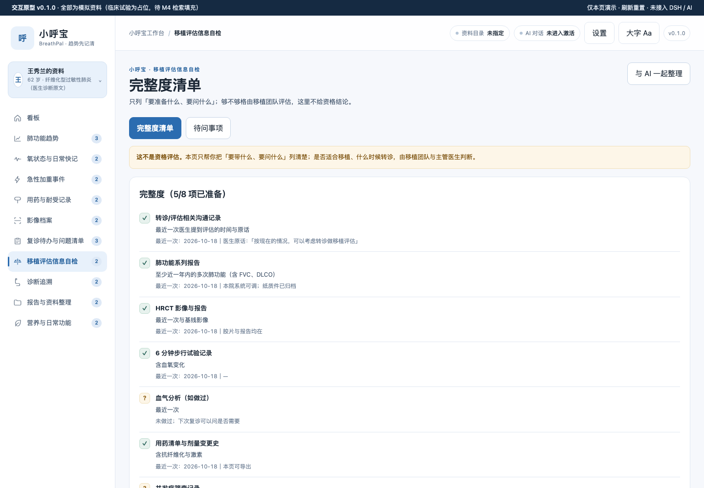
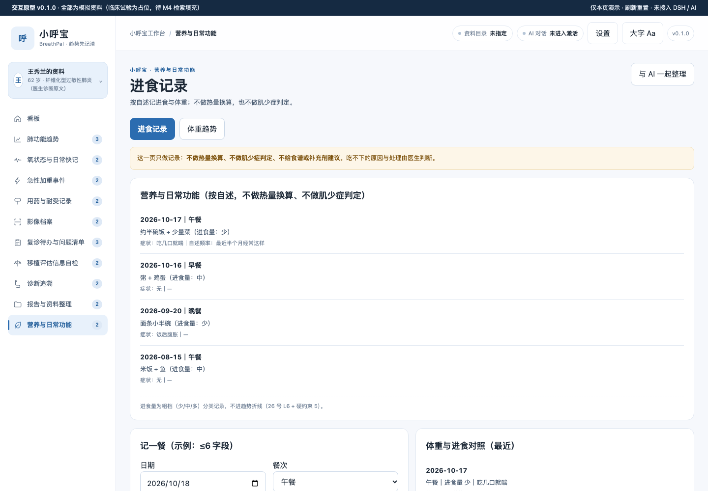
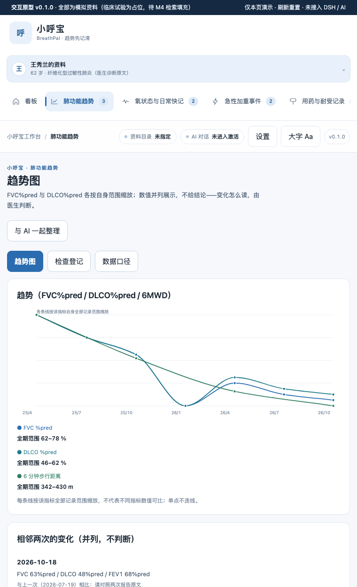
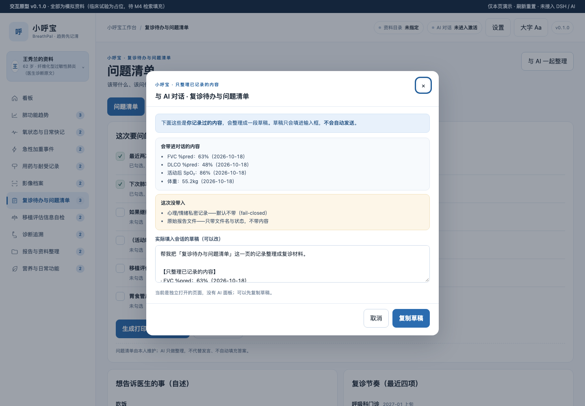

# 小呼宝 BreathPal · PF-ILD 工作台

> 面向**进行性纤维化性间质性肺疾病（PF-ILD / PPF）**患者与照护者的本机优先工作台。
> 一句话定位：**把散在报告里的肺功能、氧状态、用药与住院事件整理成一条能看懂、能带去复诊的时间线。**
>
> **不做声明**：本工作台**不做诊断、不做治疗建议、不给移植资格结论、不做热量换算**。PF-ILD/PPF 进展判定、急性加重诊断、移植适应证评估**均为医生任务**，这里只记录事实、并列展示原文、帮你准备要问的问题。

病种口径：罕见病目录 **#69**（《86 个罕见病病种诊疗指南（2025 年版）》，印刷页 408–411）· 线别 **R2 非肿瘤慢性病型** · 级别 **T1 优先**。
关键医学口径（官方指南原句）：**「PPF 不是独立的疾病诊断，更多代表疾病行为」**——所以本仓不设病因/分型选择器，只照录医生给出的诊断原文。


<details>
<summary><b>? 疾病概要</b>（定义 · 规范与指南 · 治疗全景 · 发展趋势；看板 ? 图标弹窗待各仓自行迭代落地）</summary>

**定义**：进行性纤维化性间质性肺疾病（PF-ILD / PPF）：官方指南原句「PPF 不是独立的疾病诊断，更多代表疾病行为」——本仓不设病因/分型选择器，只照录医生给出的诊断原文。

**医学资料规范和指南情况**：国家卫生健康委《86 个罕见病病种诊疗指南（2025 年版）》#69（印刷页 408–411，罕见病目录 #69）；医学核对未做；NMPA 药品适应症核对未完成（标「未核实」）。

**目前治疗全景概要**：以肺功能、氧状态、用药与住院事件的时间线整理为主；进展判定、急性加重诊断、移植适应证评估均为医生任务；本仓不载剂量与方案。

**发展趋势**：抗肺纤维化研究方向仅见于登记的临床试验（本轮仅 1 个来源算「查过」、命中 1 条 2 期研究 BMS-986278，登记状态未核实）；本仓不载疗效信息。

以上为公开资料的整理性概要，不构成诊断或治疗建议；版本与出处详见 [CLINICAL-DATA-2026](docs/CLINICAL-DATA-2026.md) 与 README 病种口径。
</details>

## 关键功能

### 看板：一眼看到「现在什么情况」和「接下来要做什么」



把 FVC%pred、DLCO%pred、活动后血氧、体重四张卡放在最上面，**只并列展示、不判断好坏**；右侧把「接下来」的复诊节奏和「还没准备的项」摊开——回答的是同一句话：*「我下次去门诊，到底该带什么、该说什么？」*

### 肺功能趋势：回答「这半年是掉还是稳」



FVC%pred、DLCO%pred 与 6 分钟步行距离**各按自身全部记录范围缩放**（图上写明"不代表不同指标数值可比"），单点不连线；相邻差值只在两次都是数值时给，缺一侧显示「缺测，无法计算」，**不插补、不给"恶化/好转"结论**。曲线用 Fritsch–Carlson 单调插值，保证不过冲——医疗信息上的视觉过冲等于误导。

### 急性加重事件：住院一次，前后怎么连





事件卡记录住院区间、起因原文、出院带药与氧疗处方、复查节点；**诊断判定留给医生**（卡上写明"具体判定以病历为准"）。治疗与事件路径用**折叠卡**承载：默认收起只显示「阶段 + 日期 + 一句话」，点开是固定五块（方案 / 指标和趋势 / 影像发现 / 副作用总结 / 支持与效果）；打印时自动全部展开。

### 移植评估信息自检：只列「要问什么」，不给「够不够格」



这是本仓与肿瘤工作台差别最大的一页：PF-ILD 的移植评估是**不可逆的时间窗口**，但"适不适合移植"必须由移植团队判断。所以这里只做**完整度清单**——哪份报告有、哪份没有、还有哪些事没了解（例如"移植中心挂号要带什么"），把不知道的变成复诊时能问出口的问题。

### 营养与日常功能：气促吃不下、体重在掉



记录进食量与症状自述，**不做热量换算、不做肌少症判定**（红线）。进食量是粗档分类（少/中/多），只做记录不进趋势折线。

### 窄宽与 AI 面板





业务区在 AI 面板打开后会变窄，因此布局按**业务区自身宽度**做三档自适应（≤1180 / ≤900 / ≤600）。「与 AI 一起整理」会把**你已记录的内容**整理成一段草稿，**逐块列出带入了什么、没带入什么**（心理/情绪私密记录默认不带），草稿只填入右侧原生会话输入框——**不会自动发送**。

## 怎么用

**尚未装机发布（M2 原型阶段）。** 当前可用方式：

```bash
# 1) 生成演示数据（唯一来源：改数据只改生成器）
node demo/build-demo-data.mjs

# 2) 用浏览器打开原型（无需构建）
open prototypes/v0.2/index.html
#    支持深链：#pft/趋势图 · #ae/事件卡?fold=1 · #visit/问题清单?draft=1 · #dashboard?agent=1
```

装机入口（M6 完成后）：DSH Desktop 本地 tgz 安装 → **重启后先新建会话**（宿主按会话授权）。

## 数据与口径

- **本机优先**：数据落 SQLite，`config.root` 指向本机资料目录；演示数据全部为虚构模拟。
- **临床试验**：占位待 M4 用 unified-trial-mcp 在线四通道检索填充；**离线语料目前只有胰腺癌**，对本病种无覆盖，如实记为「未查过」。
- **用户研究**：**0 访谈**，全部为公开二手材料；文档里所有"患者原话"位均标注「改写句，非一手引语」。
- **医学核对**：🩺 未做；NMPA 官方级药品适应症核对**未完成**（检索通道受限），已在 `research/RESEARCH-MEDICAL-2026-10-25.md` 标「未核实」。
- 版本：`v0.1.0`（原型 v0.1.0，2026-10-25）。

## 开发

```bash
npm run check      # 包合同静态检查（第一天就该绿）
npm run test       # 单测
npm run audit      # 家族一致性（交付前 0 fail）
npm run release:check
```

文档索引：
- 规格与范围：`docs/SPEC.md`｜开发计划：`docs/DEV-PLAN.md`（里程碑唯一来源）
- 差异化与重名率实测：`docs/DIFF-MATRIX.md`｜交互路径（28 号 IP1）：`docs/INTERACTION-DESIGN.md`
- 数据模型：`docs/SCHEMA.md`｜分级口径：`docs/METRIC-GRADING.md`
- 调研：`research/{FAMILY-COMPARISON,USER-RESEARCH,RESEARCH-MEDICAL}-2026-10-25.md`
- 硬约束与来源：`docs/DEV-REQUIREMENTS-2026-10-25.md`｜HVT 审核：`docs/HVT-REVIEW.md`（B=0）
